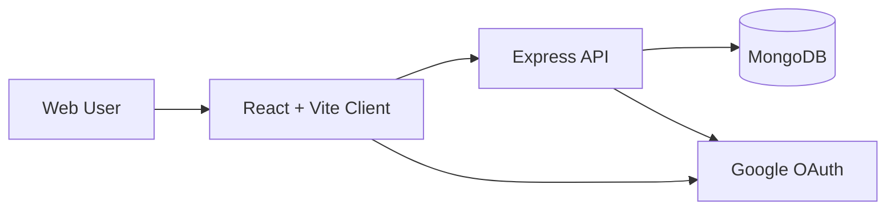
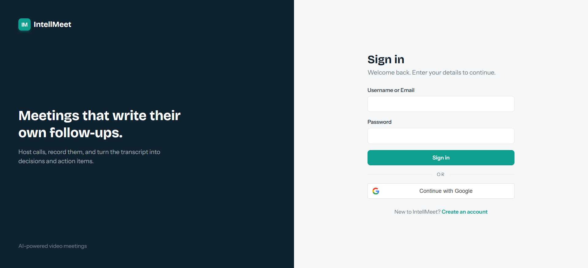
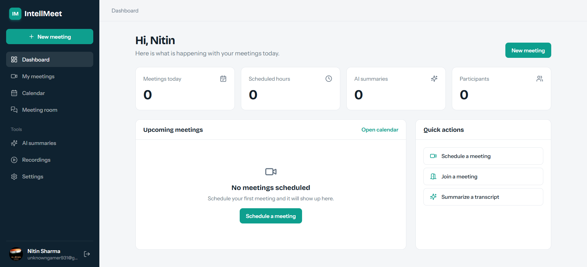
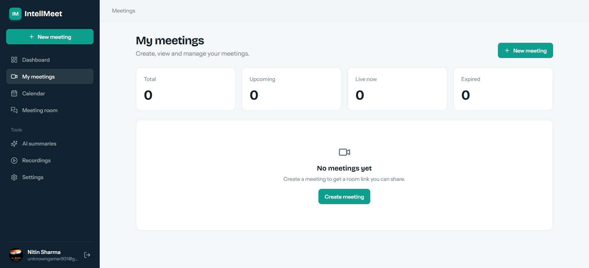
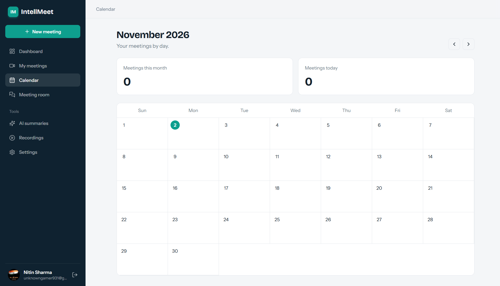
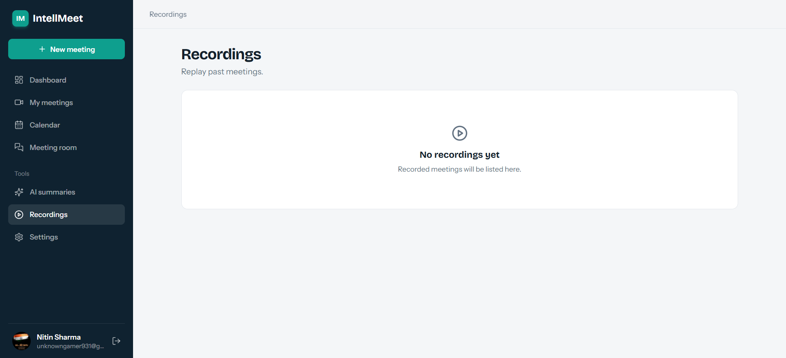
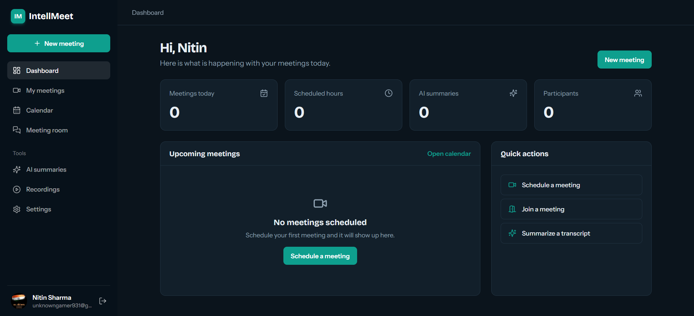

# IntellMeet

IntellMeet is a full-stack productivity and meeting platform designed for scheduling, joining, and managing digital meetings with lightweight collaboration features, AI summaries, and secure authentication.

## Why this project exists

This application brings together:

- a secure user auth flow
- meeting lifecycle management
- recording and summary support
- calendar-style dashboard experience
- Google-based sign-in for modern user onboarding

It is structured as a monorepo-style workspace with a dedicated Express API and a separate React frontend.

## Architecture overview



## Tech stack

### Frontend

- React 19
- Vite
- React Router
- Lucide icons
- `@react-oauth/google`
- custom Tailwind-inspired styling

### Backend

- Node.js
- Express 5
- MongoDB + Mongoose
- JWT auth with access/refresh tokens
- Google Auth library
- Cookie-based session support
- Socket.io for meeting features

## Feature list

- Email/password authentication
- JWT-based access and refresh tokens
- Google login with ID-token verification
- Meeting creation and access flow
- Meeting invites and member tracking
- Dashboard and calendar pages
- Recording area
- AI summary support
- User profile avatar and display name handling
- Responsive layout for modern web use

## Repository structure

```text
intellmeet_1/
├── backend/
│   ├── src/
│   ├── .env
│   ├── package.json
│   └── README.md
├── client/
│   ├── src/
│   ├── .env
│   ├── package.json
│   └── README.md
├── README.md
├── .gitignore
└── package-lock.json (if present)
```

## Prerequisites

Before running the application, install:

- Node.js 18+
- Bun or npm
- MongoDB running locally or via Atlas

## Local startup guide

### 1. Clone the repository

```bash
git clone <repo-url>
cd intellmeet_1
```

### 2. Start MongoDB

Make sure MongoDB is running locally on:

```text
mongodb://127.0.0.1:27017
```

### 3. Configure environment variables

#### Backend

Create `backend/.env`:

```env
PORT=5000
NODE_ENV=development

MONGODB_URI=mongodb://127.0.0.1:27017/IntellMeet
DATABASE_URL=mongodb://127.0.0.1:27017
DB_NAME=IntellMeet

CLIENT_URL=http://localhost:5173

ACCESS_TOKEN_SECRET=your_access_secret
JWT_ACCESS_SECRET=your_access_secret
REFRESH_TOKEN_SECRET=your_refresh_secret
JWT_REFRESH_SECRET=your_refresh_secret

GOOGLE_CLIENT_ID=your_google_oauth_client_id
GOOGLE_CLIENT_SECRET=your_google_oauth_client_secret
```

#### Frontend

Create `client/.env`:

```env
VITE_API_URL=http://localhost:5000/api
VITE_GOOGLE_CLIENT_ID=your_google_oauth_client_id
```

### 4. Install dependencies

Backend:

```bash
cd backend
bun install
```

Frontend:

```bash
cd client
bun install
```

### 5. Run the app

Start the backend:

```bash
cd backend
bun run dev
```

Start the frontend in another terminal:

```bash
cd client
bun run dev
```

### 6. Open the app

- Frontend: `http://localhost:5173`
- Backend API: `http://localhost:5000`
- Health route: `http://localhost:5000/api/health`

## Default developer workflow

### Backend commands

```bash
cd backend
bun run dev
bun run start
```

### Frontend commands

```bash
cd client
bun run dev
bun run build
bun run preview
```

## Google OAuth setup

To enable Google login:

1. Open Google Cloud Console
2. Create a new OAuth 2.0 Client ID for a Web application
3. Add these authorized JavaScript origins:
   - `http://localhost:5173`
   - `http://localhost:5000`
4. Add the matching client ID and client secret to `backend/.env` and `client/.env`
5. Restart both frontend and backend after changing env values

## Authentication flow

- User signs in using email/password or Google
- Backend validates credentials
- JWT access and refresh tokens are issued
- User data is stored in MongoDB
- Frontend persists session state and loads the current user on startup

## Environment notes

- The project expects local development values and localhost origins.
- The app uses `CLIENT_URL` and `VITE_API_URL` for local cross-origin access.
- For production, replace local origin values with your production domain and update CORS and OAuth configuration.

## Screenshots

### Login page



### Dashboard



### Meeting list



### Meeting room



### AI summary view



### Recordings view



## Production readiness checklist

Before deploying to production, verify:

- environment variables are set for production
- MongoDB is reachable in production
- CORS is restricted to trusted domains
- Google OAuth redirect/origin values are updated
- JWT secrets use secure production values
- HTTPS is enabled
- API keys and secrets are not committed to source control
- logging and monitoring are configured

## Team notes

This project is designed to be easy to hand off to another developer. The frontend and backend are intentionally split so the API contract remains manageable and the app remains easy to extend.

## License

This project is intended for local development and internal product use unless otherwise specified by the project owner.
